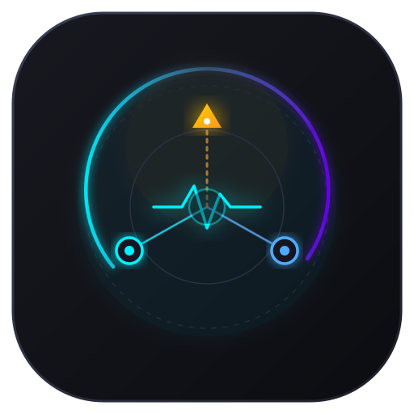

# PulseDeck

<p align="center">
  
</p>

<p align="center">
  <strong>Le Cockpit de Pilotage et de Gouvernance d'Agents Développeurs</strong><br />
  <em>Orchestration par workflows DAG (Moteur Operon) & Sécurité stricte (Protocole Aegis)</em>
</p>

<p align="center">
  
  
  
  
  
</p>

---

## Vue d'ensemble

**PulseDeck** est une application de bureau conçue pour combler le fossé entre la **gestion de projet logiciel** et **l'exécution par des agents d'intelligence artificielle autonomes**.

Contrairement aux simples fenêtres de discussion ou aux extensions d'édition dans l'éditeur, PulseDeck agit comme une tour de contrôle macroscopique :
- **Repo-Native (Docs-as-Code) :** Aucune base de données externe opaque. Les Cycles, Feats, Pulses, Tickets, Workflows et Mémoires sont stockés directement dans le dépôt sous forme de fichiers Markdown avec en-tête YAML versionnables avec Git.
- **Moteur Operon :** Modélisation et exécution de workflows sous forme de graphes orientés (DAG) avec branches conditionnelles (`ok`, `échec`, `bloqué`), scripts et sous-agents.
- **Protocole Aegis (Human-in-the-loop) :** L'agent dispose d'une lecture libre du code, mais chaque modification de fichier, commande shell ou script sensible passe obligatoirement par le sas **« À traiter »** pour obtenir votre accord explicite.
- **Multi-modèles agnostique :** Supporte l'Agent SDK Claude (Haiku, Sonnet, Opus), les modèles locaux via Ollama (`qwen2.5-coder`, `gpt-oss`, etc.) et prêt pour le protocole ACP (`agy`).

---

## Les Modes de l'Application

PulseDeck s'organise en 8 modes de travail complémentaires :

| Mode | Rôle & Fonctionnalités |
| :--- | :--- |
| **Développement** | Console d'exécution interactive. Suivi en temps réel des actions de l'agent, diffs, journal d'outils et suggestions contextuelles. |
| **Architecture** | Éditeur visuel de workflows DAG (Operon Engine), journal des appels MCP, gestionnaire de scripts exécutables (`scripts/`) et historique des versions. |
| **Projet** | Vision produit structurée : Cycles stratégiques (`cycles/`), Spécifications et fonctionnalités (`feats/`), Unités d'exécution (`pulses/`) et suivi des Tickets CSV. |
| **Documentation** | Bibliothèque documentaire du projet (ADR, cookbooks, runbooks, guides) indexée, modifiable et synchronisée avec le dépôt. |
| **Fichiers** | Explorateur d'arborescence du dépôt avec prévisualisation et propositions de modifications assistées par IA. |
| **Stats** | Observabilité complète : consommation de tokens (entrée/sortie), coûts financiers réels en USD et répartition par tâche et modèle. |
| **À traiter** | Le sas de sécurité Aegis. Point de contrôle obligatoire pour valider ou rejeter les actions critiques des agents. |
| **Options** | Configuration des dossiers de travail, des modèles d'IA par défaut, des modèles locaux Ollama et des gabarits d'écriture. |

---

## Structure du Dépôt Piloté

Dans tout projet ouvert avec PulseDeck, la structure suivante fait office d'unique source de vérité :

```text
mon-projet/
├── cycles/            # C-n.md : Cycles et jalons temporels
├── feats/             # F-n.md : Spécifications fonctionnelles avec budget token
├── pulses/            # P-n.md : Tâches concrètes reliées à un workflow
├── workflows/         # *.md   : Définition des graphes de nœuds DAG
├── docs/              # **/*.md: Documentation vivante (ADR, guides, specs)
├── scripts/           # *.sh, *.py, *.mjs : Scripts réels exécutables
├── memory/            # Mémoire persistante du projet pour les agents
├── sessions/          # Comptes-rendus horodatés des runs d'agents
└── Tickets/           # <nom-projet>.csv : Fichier de tickets synchronisable
```

---

## Installation & Démarrage

### Prérequis
- **Node.js** >= 20
- **npm** >= 10
- Pour les modèles locaux : **Ollama** lancé localement (`http://localhost:11434`)

### 1. Installation des dépendances
```bash
npm install
```

### 2. Lancement en mode développement
Pour lancer l'application de bureau Electron avec rechargement à chaud :
```bash
npm run dev
```

Pour lancer uniquement l'interface web dans le navigateur :
```bash
npm run dev:web
```

### 3. Vérification des types TypeScript
```bash
npm run typecheck
```

### 4. Compiler pour macOS
Pour produire le binaire exécutable autonome (`PulseDeck.app`) :
```bash
npm run build
```
Le bundle compilé se trouve dans `dist/electron/Packaged/PulseDeck-darwin-arm64/PulseDeck.app`.  
Pour l'installer dans vos applications macOS :
```bash
cp -R dist/electron/Packaged/PulseDeck-darwin-arm64/PulseDeck.app /Applications/
```

---

## Architecture Technique

- **Front-end :** Vue 3 (Composition API, `<script setup>`), Quasar Framework v2, Vite.
- **Processus Principal (Electron) :**
  - `src-electron/electron-main.ts` : Cycle de vie de l'application et pont IPC.
  - `src-electron/project-store.ts` : Surveillance et manipulation des fichiers Markdown/YAML du dépôt.
  - `src-electron/workflow-engine.ts` : Moteur d'exécution DAG Operon.
  - `src-electron/claude-runner.ts` : Orchestration de l'Agent SDK avec barrière de sécurité Aegis.
  - `src-electron/ollama.ts` : Détection et interrogation des modèles d'inférence locaux.
  - `src-electron/stats.ts` : Métriques et calculs des coûts tokens.

---

## Philosophie de Conception

1. **Aucun agent ne s'exécute sans accord :** La lecture est fluide et transparente, mais toute action ayant un impact (écriture de fichier, commande shell) requiert une approbation humaine dans le sas « À traiter ».
2. **Texte et interface sobres :** Conçu pour des sessions de développement prolongées avec un thème sombre natif haute lisibilité.
3. **Pérennité :** Tout ce qui est produit par les agents reste dans vos fichiers markdown Git. Vous n'êtes jamais captif de l'outil.
